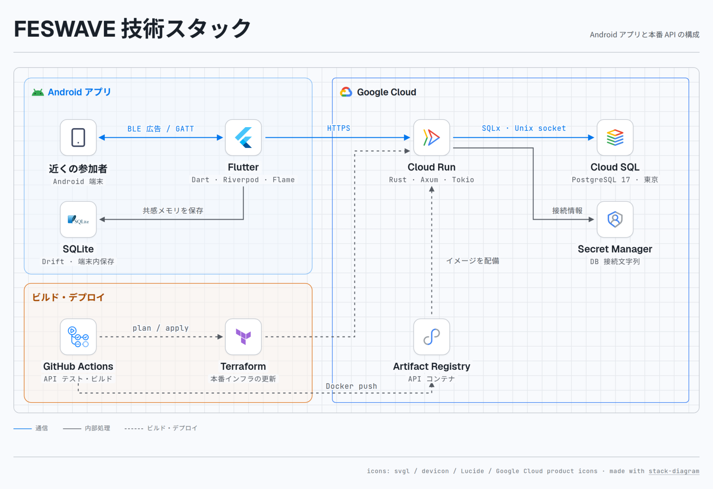

# FESWAVE

  <picture>
    <source media="(prefers-color-scheme: dark)" srcset="apps/feswave_android/assets/feswave.svg">
    
  </picture>

  
  
  

ライブで好きなフレーズが流れたら、スマホの画面をタップします。近くで同じように反応した人がいると、その人が公開している曲が「共感メモリ」として自分の端末に残ります。ライブのあとでも「メモリ」を開いて曲を見返せます。

## 2台で試す

Android 12以上で、Bluetooth LEの広告とスキャンに対応したarm64端末を2台用意してください。曲を手入力すれば、ゲストのままオフラインで試せます。[最新版APKをダウンロード](https://github.com/mashumarrow/feswave/releases/latest/download/feswave-android-arm64.apk)

1. 両方の端末にAPKを入れ、Bluetooth・位置情報・自動日時設定をオンにします。
2. 各端末のプロフィールでニックネームと好きな曲を登録し、「好きな曲とアイコンを公開」をオンにして保存します。
3. 「ライブを始める」を押し、付近のデバイスと正確な位置情報の権限を許可します。2台を近くに置くと、ライブ画面に相手のアイコンが現れます。
4. 相手のアイコンが見えたら、2人で同じ5秒間に同じくらいタップします。相手のアイコンから波紋が広がり、近さとタップの条件がそろうと「メモリ」に相手と曲が残ります。

ライブ画面右上のマイクをオンにすると、周囲の音に合わせて中央のリングが動きます。音声は端末内で解析し、保存も送信もしません。

## 共感メモリが残る仕組み

2台のスマホがBluetoothで一時IDとタップの反応レベルを交換します。アプリは電波の強さから相手の近さを推定し、同じ5秒間の反応を比べます。条件がそろうと相手の公開プロフィールを直接読み取り、自分の端末に保存します。

Pixel 4とRedmi Note 10 JEで距離を変えて各1回試したところ、1 mでは両方の端末にメモリが残り、2 mではどちらにも残りませんでした。電波の強さは機種や持ち方で変わり、混雑した会場での誤判定率は未評価です。[試験条件と実測値](apps/feswave_android/verification/README.md)

## 技術スタック

| 機能 | 主な技術と役割 |
| --- | --- |
| ライブ画面 | Flutter（Dart）で画面を構成し、Flameで参加者と波紋を描画します。 |
| 端末間の通信 | AndroidのBluetooth機能を使い、BLE広告で反応を交換します。公開プロフィールはGATTで読み取ります。 |
| 共感メモリ | Driftを使って相手と曲を端末内のSQLiteに保存し、Riverpodを通じて履歴を画面に反映します。 |
| 曲検索・プロフィール同期 | Cloud Run上でRustのAPI（Axum・Tokio）が動きます。曲検索にはiTunes Search APIを使い、プロフィールはCloud SQLのPostgreSQLに保存します。 |

[端末間通信・音声解析・認証の詳細図](docs/images/runtime.png) · [開発ガイド](docs/development.md) · [本番環境の構成](infra/README.md)

## ライセンス

ソースコードは[MITライセンス](LICENSE)で公開しています。依存ライブラリや第三者素材の利用条件は[ライセンス一覧](THIRD_PARTY_LICENSES.md)を参照してください。
